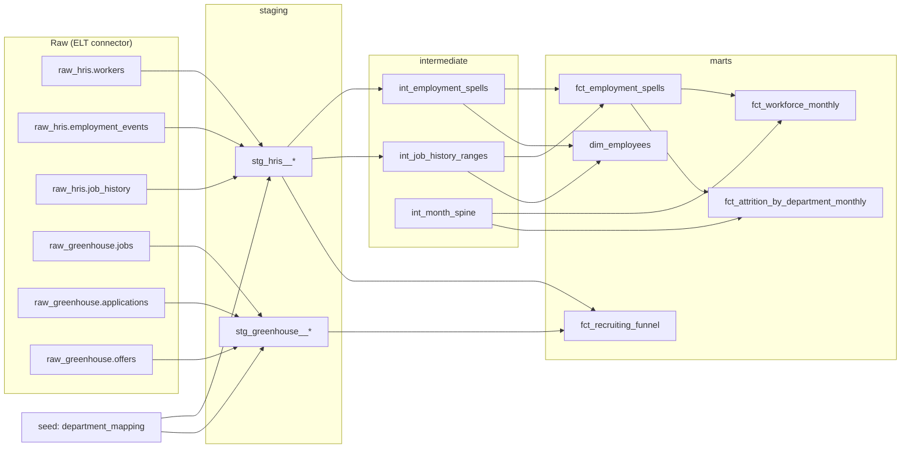
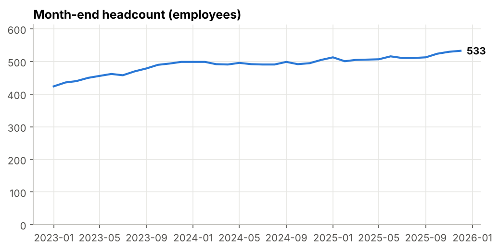
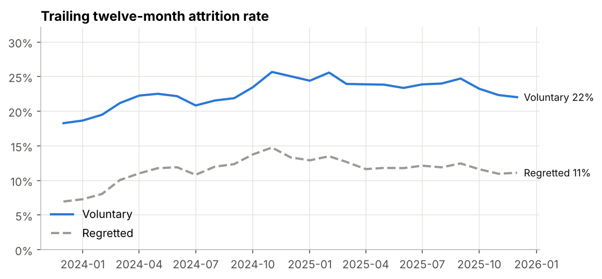
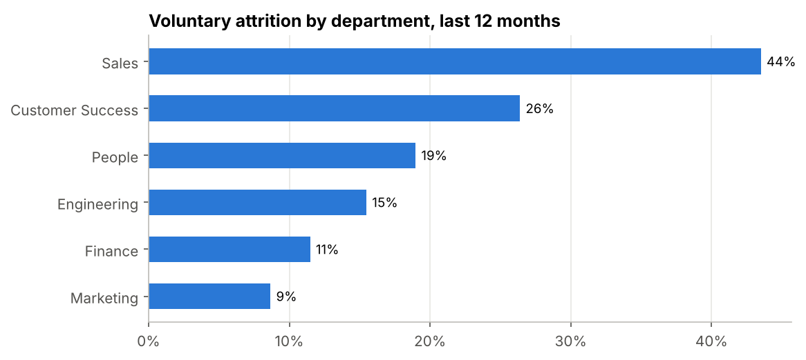
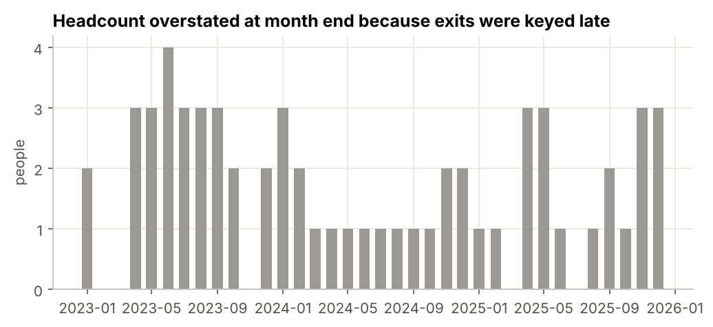
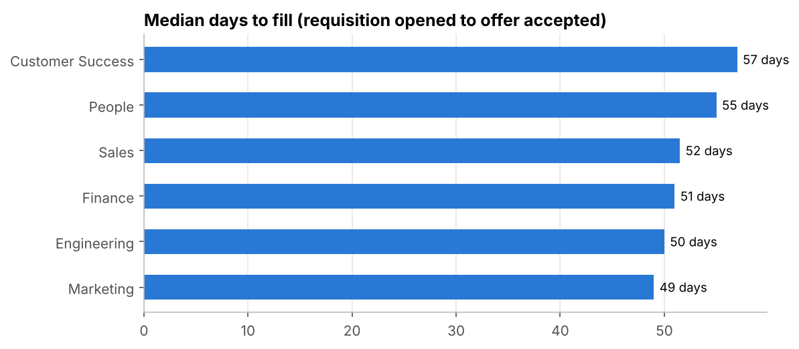

# People Analytics with dbt: one source of truth for workforce and recruiting metrics

A dbt project that turns messy HRIS and ATS exports into tested, documented workforce metrics:
headcount, hires, voluntary and regretted attrition, time to fill and offer acceptance.

The raw data is synthetic, but it carries the problems real People data has: rehires, late-entered
terminations, duplicated connector rows, corrected job records, contractors mixed with employees,
no-shows and department names that differ between systems. Each problem is injected on purpose, counted,
and handled by a model or caught by a test.

**Stack:** dbt Core · DuckDB (local stand-in for Snowflake) · SQL · Python for data generation and charts.

---

## Quick start

```bash
python -m venv .venv && source .venv/bin/activate
pip install -r requirements.txt
make all        # generate raw data -> dbt build (models + 77 tests) -> charts and CSV exports
make docs       # browse the lineage graph and column documentation
```

`make all` ends with `PASS=75 WARN=2 ERROR=0`. The two warnings are data-quality monitors, explained below.

## Architecture



| Layer | Purpose |
|---|---|
| **staging** | One model per source table: rename, cast, deduplicate, map departments. No business logic. |
| **intermediate** | Reusable building blocks: employment spells, effective-dated job ranges, a month calendar. |
| **marts** | What stakeholders query: workforce roll-forward, attrition by department, recruiting funnel. |

## Metric definitions

These are the rules every number in the marts follows. They live in the model headers and in `dbt docs`.

| Metric | Definition |
|---|---|
| **In scope** | Employees only. Contractors and no-shows (accepted, never started) are excluded through one column, `fct_employment_spells.is_in_workforce_metrics`. |
| **Active at end of day *d*** | `hire_date <= d` and (`last_day_worked` is null or `last_day_worked > d`). A person whose last day is the last day of the month is a termination of that month and is not in its closing headcount. |
| **Roll-forward** | `headcount_end = headcount_start + hires - terminations`, every month. Tested. |
| **Attrition rate** | Terminations in the period / average of opening and closing headcount. |
| **T12M attrition** | Exits in the last 12 months / mean of the 12 monthly average headcounts. |
| **Regretted attrition** | Voluntary exits flagged as a loss the company wanted to avoid. |
| **Department** | Headcount uses the department held on the reference date; exits use the department on the last day worked. |
| **Time to fill** | Days from requisition opened to offer accepted. |
| **As reported vs. restated** | `headcount_end_as_reported` uses only terminations keyed in the HRIS by month end. `headcount_end` uses everything known today. The gap is the restatement caused by late data entry. |

## Edge cases: what was injected and how it is handled

Counts are for the default seed (`--seed 42`); `scripts/generate_data.py` prints them on every run.

| Injected issue | Count | Handled by | Proof |
|---|---:|---|---|
| Connector landed the same event twice | 21 | `stg_hris__employment_events` keeps the latest sync per `event_id` | `unique` test on `event_id` |
| Job record corrected with the same effective date | 40 | `stg_hris__job_history` keeps the latest `entered_at` per employee and date | `unique_combination` test |
| Department spelled differently (`"Cust. Success"`, `"customer success "`, ATS taxonomy) | 16 variants | `department_mapping` seed, joined after `lower(trim())` | `not_null` on mapped department: a new spelling fails the build until it is mapped |
| Rehires with the same employee ID | 22 | `int_employment_spells`: one row per stint | Spells cannot overlap; every termination closes exactly one spell |
| No-shows (hire and termination on the same day) | 4 | Excluded via `is_in_workforce_metrics` | Event-level recount reconciles with the mart |
| Contractors in the HRIS | 75 | Excluded via `is_in_workforce_metrics` | Event-level recount reconciles with the mart |
| Internal transfers between departments | 80 | Effective-dated job ranges | Department headcount sums to company headcount every month |
| Terminations keyed more than 30 days late | 40 | `headcount_end_as_reported` vs. `headcount_end` | **Warning monitor** `warn_terminations_entered_late` → `WARN 40` |
| Hires whose ATS candidate is missing in the HRIS | 21 | `fct_recruiting_funnel.hired_employee_id` stays null | **Warning monitor** `warn_accepted_offers_not_linked_to_hris` → `WARN 21` |
| Declined offers before the accepted one | 69 | Counted in `offers_extended` | At most one accepted offer per requisition |

Warnings don't fail the build: the data is usable, but someone should fix the source. That is the
difference between a broken pipeline and a data-quality backlog.

## Tests (77)

- **Generic tests** on keys, accepted values and relationships, including conditional ones
  (for example, `termination_type` is required only for termination events).
- **Reconciliation tests**, written as plain SQL in `tests/`:
  - `assert_workforce_rollforward`: closing = opening + hires − terminations, and each month opens where the last one closed.
  - `assert_headcount_reconciles_with_events`: recounts the closing headcount straight from raw events,
    without spells or marts, and compares it with the mart.
  - `assert_department_headcount_sums_to_total`: catches holes in effective-dated job history.
  - `assert_spells_do_not_overlap`, `assert_no_orphan_terminations`, `assert_last_day_not_before_hire`.
- **Monitors** with `severity: warn` for issues that need a fix at the source, not in the model.

### Try breaking it

Insert a job record with a typo (`'Engineeering'`) and a rehire that starts while the person is still
employed, then run `dbt build`:

```
FAIL 1 not_null_stg_hris__job_history_department
FAIL 1 assert_spells_do_not_overlap
Done. PASS=54 WARN=2 ERROR=2 SKIP=19
```

The 19 downstream models and tests are skipped, so no dashboard is refreshed with bad numbers.
`make data` restores the clean dataset.

## Results (synthetic data, as of 2025-12-31)

| KPI | Value |
|---|---:|
| Headcount (employees) | 533 |
| Voluntary attrition, trailing 12 months | 22.0% |
| Regretted attrition, trailing 12 months | 11.1% |
| Median days to fill | 53 |
| Offer acceptance rate | 88% |





Sales loses people at about five times the rate of Marketing. That is where retention work pays off first.



Late-keyed exits made month-end headcount reports overstate the workforce by up to 4 people. Small, but it
means every published number changes after the fact unless the report states its as-of date and the
restatement is tracked.



`make report` also exports every mart to `exports/*.csv`, ready to load into Hex, Sigma or Tableau.

## Design decisions

- **Spells, not people.** A rehired person has two stints. Modeling spells keeps tenure, hires and exits
  correct, and makes "rehire rate" a one-line query.
- **One switch for scope.** Every workforce metric filters on `is_in_workforce_metrics`, so the definition
  of "who counts" lives in one place.
- **Mappings as a seed, not as `CASE` statements.** People and HRIS admins can review a CSV; a new
  department spelling breaks the build loudly instead of silently becoming "Other".
- **Restated and as-reported numbers side by side.** Leaders compare this month's deck with last month's;
  showing the restatement explains why a number moved without anyone changing the data.
- **No packages.** The one generic test it needs (`unique_combination`) is a ten-line macro, so the project
  runs offline.

## Moving to a warehouse

The models use standard SQL plus a few DuckDB functions (`date_diff`, `qualify`, `range`). To run on
Snowflake, add a Snowflake target to `profiles.yml`, point the sources at the connector schemas and
replace `range()` in `int_month_spine` with a date spine.

## Project layout

```
├── scripts/generate_data.py      # synthetic HRIS + ATS raw tables, with injected issues
├── seeds/department_mapping.csv  # source spellings -> canonical department
├── models/
│   ├── staging/hris/             # workers, employment events, job history
│   ├── staging/greenhouse/       # jobs, applications, offers
│   ├── intermediate/             # spells, job ranges, month spine
│   └── marts/                    # workforce, attrition, recruiting
├── tests/                        # reconciliation tests and warning monitors
├── macros/                       # schema naming, unique_combination test
└── report/build_report.py        # charts and CSV exports from the marts
```

---

All data in this repository is synthetic and generated by `scripts/generate_data.py`.
